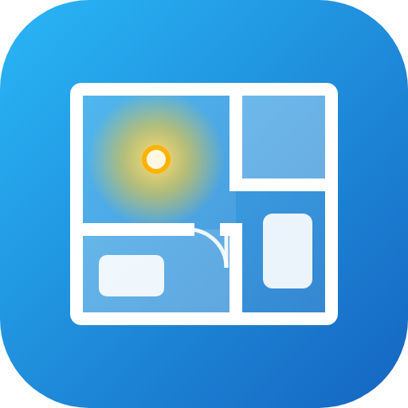
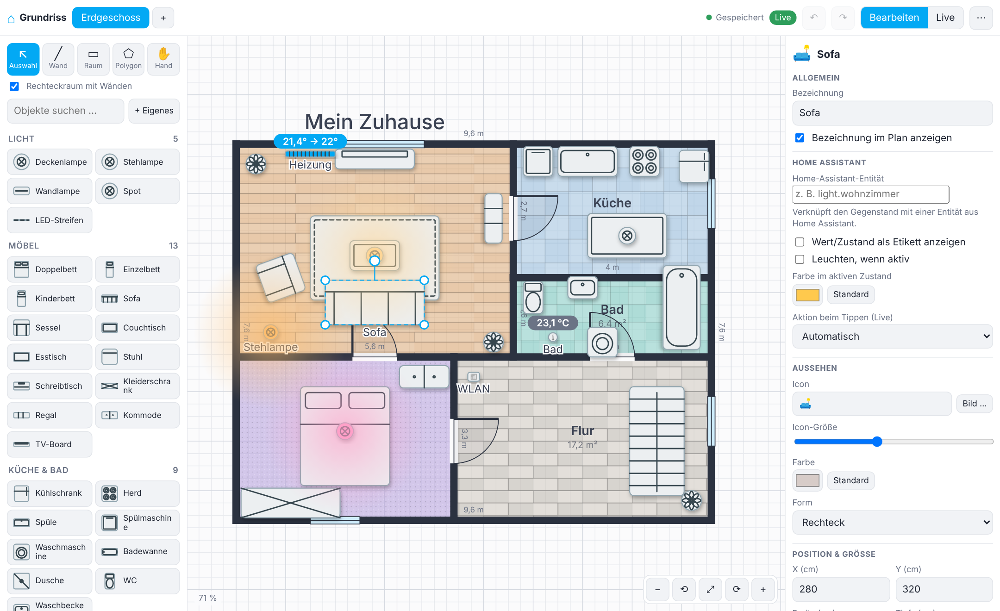
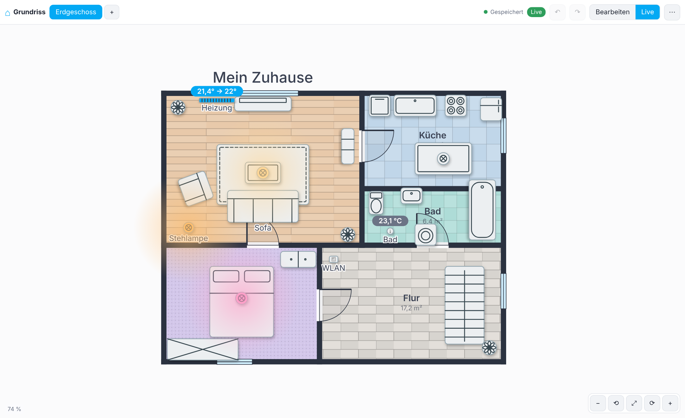
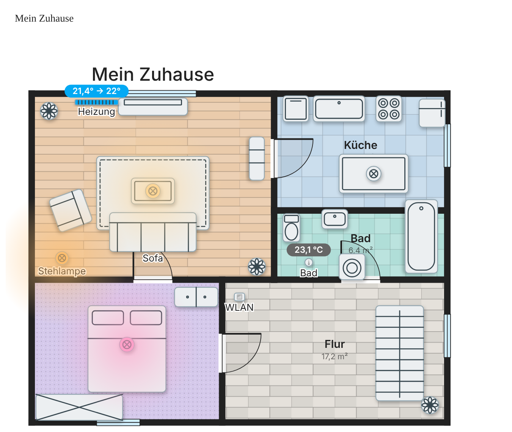

<p align="center"></p>

# Floorplan Studio für Home Assistant (HACS)

[](https://www.paypal.me/HAlexander275)

Zeichne deinen Grundriss direkt in Home Assistant – Wände, Räume, Türen, Fenster, Lampen, Möbel, Heizungen, Sensoren … alles frei konfigurierbar – und nutze ihn als **Live-Dashboard**: Lampen leuchten, Heizungen zeigen die Temperatur, Tippen schaltet.



| Live-Modus | Dashboard-Karte |
|---|---|
|  |  |

📖 **[Ausführliche Anleitung](docs/ANLEITUNG.md)**

## Installation über HACS

1. HACS → ⋮ (oben rechts) → **Benutzerdefinierte Repositories**
2. Repository-URL: `https://github.com/Hettinger91/Floor-Planer-2D-Home-assistant`, Typ: **Integration** → Hinzufügen
3. „Floorplan Studio“ in HACS suchen → **Herunterladen**
4. Home Assistant **neu starten**
5. *Einstellungen → Geräte & Dienste → Integration hinzufügen → Floorplan Studio* (ein Klick, keine Einstellungen)

Danach erscheint in der Seitenleiste der Eintrag **Grundriss**.

> Hinweis: HACS kann keine Supervisor-Apps (Add-ons) installieren. Deshalb ist Floorplan Studio eine Integration – sie bringt das Panel, die Speicherung und die Dashboard-Karte selbst mit und läuft auch ohne Supervisor (Docker, Core, HAOS).

### Manuell (ohne HACS)
Ordner `custom_components/floorplan_studio` nach `<config>/custom_components/` kopieren, neu starten, Integration hinzufügen.

## Entitäten verknüpfen
* Objekt auswählen → **Auswählen …** öffnet eine Suche mit Filter nach Typ und Bereich.
* Tab **Entitäten** links: Zeile auf den Plan ziehen oder mehrere ankreuzen und platzieren – Objekttyp, Beschriftung, Wertanzeige und Leuchten werden automatisch gesetzt.

## Individuell gestalten
* **Symbol-Stil** (Einstellungen → Ansicht): Modern-neutral (Standard), Klassisch (Architektenplan), Farbig-dezent oder Emojis. Eigene Icons und Bilder pro Objekt bleiben möglich und haben Vorrang vor dem Symbol.
* Jeder Raum: Farbe, **Bodenbelag** (Holz, Fliesen, Stein, Teppich, Rasen, Beton) mit Größe und Drehung des Musters.
* Jedes Objekt: Farbe, Form, Größe, Symbol, Beschriftung, Leuchtfarbe; eigene Objekttypen in der Bibliothek; Schatten global schaltbar.
* Wände (Farbe, Dicke, gestrichelt), Türen/Fenster, Hintergrundbild als Vorlage, mehrere Etagen.

## Ansicht drehen
Am Tablet mit zwei Fingern drehen und zoomen; am PC mit Rechtsklick-Ziehen, Shift+Mausrad, den Tasten Q/E oder den Knöpfen ⟲ ⟳ (90°). **Dashboard-Karte:** Ziehen = verschieben, zwei Finger = zoomen + verschieben, Strg+Mausrad = zoomen, Doppelklick = zurücksetzen; Drehen ist standardmäßig aus und lässt sich mit `rotate_gesture: true` einschalten (dann Ein-Finger-Ziehen = drehen, zwei Finger drehen, Shift+Mausrad = drehen); Knöpfe unten rechts. Antippen von Objekten schaltet wie gewohnt. Abschalten mit `gestures: false`. **Editor:** Knopf ◎ schaltet den Dreh-Modus (Ein-Finger-/Maus-Ziehen dreht statt zu verschieben). Längen werden in **Metern** eingegeben (Einstellung „Einheit“ → cm möglich). In den Einstellungen kann die Drehung als **Ausrichtung** gespeichert werden – sie gilt dann auch auf der Dashboard-Karte (oder per `rotate:` in der Karte).

## Feinschliff pro Objekt / Raum
* **Bezeichnung** lässt sich direkt im Plan über den kleinen Griff am Text drehen (Objekt anklicken), **Wert/Zustand** (die Kapsel über dem Objekt) ebenfalls über einen Griff im Plan. Mit „Bezeichnung = Name der Entität“ übernimmt der Plan den Namen automatisch aus Home Assistant.
* **Leuchten, wenn aktiv:** Effekt (weich, stark, Ring, pulsierend), **Leuchtradius** und **Intensität** einstellbar.
* **Raum:** Breite, Tiefe und Position als Zahlen ändern – Wände an den Raumecken wandern mit.

## Objekte & eigene Symbole
Die Bibliothek enthält über 260 Objekte (Möbel, Küche & Bad, Heizung & Klima, rund 75 Smart-Home-Geräte, Büro & Medien, Außen & Garage, Kinder & Haustiere, Bau & Deko). Mit **+ Eigenes** legst du eigene Objekte an – mit **Icon (Emoji)**, **Bild** (z. B. Draufsicht, Upload oder URL) oder beidem; das Bild lässt sich eingepasst, gestreckt oder ohne Fläche darstellen. Jedes platzierte Objekt kann im Inspektor ebenfalls ein eigenes Icon/Bild bekommen, und über „Als Vorlage speichern“ wird es zur wiederverwendbaren Vorlage.

## Garten

Oben in der Etagenleiste **🌿+** = Garten-Ebene hinzufügen: Rasenfläche, blasser Hausumriss zur Orientierung, Wände werden zu Zäunen. Bodenarten für Flächen: Rasen, Kies, Pflaster, Holzdeck, Sand, Erde, Wasser. Kategorie **Garten** in der Bibliothek mit ~100 Objekten (Bäume, Beete, Teich, Gewächshaus, Pergola, Möbel, Wege, Leuchten, Mähroboter, Bewässerung, Sensoren …). In 3D steht der Garten immer um das Haus herum.

## Live-Übersicht (neu in 1.1.0)

Im Live-Modus des Editors und in der Dashboard-Karte erscheint oben links eine Übersicht (ausblendbar: Karte `overlay: false`, Inspektor „Live-Übersicht“):

* **🚨 Alarme:** Rauch-, Gas-, Wasser-, CO-, Störungs- und Sabotage-Melder (`binary_sensor` mit passender Geräteklasse) blinken rot; zusätzlich Warnung bei offenen Fenstern/Türen, wenn niemand (`person.*`) zuhause ist.
* **👤 Anwesenheit:** Wer ist zuhause (alle `person`-Entitäten).
* **⚡ Energiefluss:** Im Inspektor „Live-Übersicht“ PV-, Netz-, Akku- und Hausverbrauchs-Sensor wählen (W oder kW, Vorzeichen umkehrbar) – animiertes Flussdiagramm mit Richtung und Leistung.
* **Szenen:** Szenen, Skripte oder Taster (je Zeile `scene.kino|Kino`) als Buttons.
* **🕒 Tageszeit-Regler** in der 3D-Ansicht mit Look „Live“: Sonnenstand/Schatten für jede Uhrzeit ansehen, „Jetzt“ springt zurück.
* **Raum-Heatmap:** Inspektor „Live-Übersicht“ → Temperatur, Luftfeuchte oder CO₂ färbt Räume (mit HA-Bereich) in 2D und 3D ein; Karte: `heat: temp | hum | co2`.
* **Kiosk-Modus** (Karte): `kiosk: true` – Vollbild-Knopf, größere Touch-Flächen, nach `kiosk_idle` Sekunden (Standard 90) ohne Bedienung Rückkehr zur Startansicht.
* **Stückliste & Druck:** Editor-Menü → „Stückliste & Flächen“ (Räume, Flächen, Wandlängen, Objekte; CSV-Export) und „Drucken / als PDF“ (Pläne mit Maßstabsangabe, optional mit Stückliste).
* **Pultdach** als weitere Dachform (inkl. Solarmodulen).
* **Mehrere Gebäude:** Etagen-Feld „Gebäude“ bzw. Knopf **🏠+** in der Etagenleiste. Jedes Gebäude stapelt eigene Etagen und bekommt ein eigenes Dach; Karte: `building: Garage` zeigt nur dieses Gebäude.
* **Begehen (🚶):** Ego-Perspektive durchs Haus (3D-Leiste bzw. Karten-Seitenleiste): Ziehen = umsehen (Touch: seitlich drehen, senkrecht laufen), WASD/Pfeile, Mausrad = vor/zurück, Esc beendet. Wände sind fest, Türen gehbar.
* **Sensor-Verlauf:** Tippen auf einen Sensor (Temperatur, Luftfeuchte, CO₂, Leistung …) öffnet ein Diagramm (6 h / 24 h / 7 Tage) aus der HA-Historie. Räume mit Bereich und ohne Licht öffnen den Verlauf ihrer Sensoren.
* **Kamera-Popup:** Objekte mit `camera.*`-Entität zeigen Foto (automatisch aktualisiert) oder Live-Stream im Popup.
* **Druck / PDF im Maßstab:** Menü → „Drucken / als PDF“: Format A4–A2, Maßstab 1 : 20 bis 1 : 1000 oder automatisch, Maßstabsbalken, optional Stückliste. Zeichnung exakt in mm skaliert.
* **VR / AR (WebXR):** Auf Geräten mit WebXR erscheinen in der 3D-Leiste 🥽 VR (Haus im Maßstab 1:1 begehen, Stick = laufen, mit Wandkollision) und 📱 AR (Modell auf dem Tisch, Stick = drehen). Ohne WebXR-Unterstützung bleiben die Knöpfe verborgen.
* **Realistisch-Modus (✨):** Schalter in der 3D-Leiste (Editor) bzw. Seitenleiste der Karte (Option `realistic: true`) für Geräte mit mehr Rechenleistung. Physikalisch basierte Materialien mit prozeduralen Details (Putz, Dachziegel, Rasen, Holz, Stein), Himmel mit Sonnenstand und Wetter, Umgebungslicht, weiche Schatten, Umgebungsverdeckung (SSAO) und Glas mit Spiegelungen. Lädt die zusätzliche Bibliothek `vendor/three-real.js` (~700 kB) nur bei Bedarf; ohne den Schalter bleibt alles beim schlanken Standard.
* **Plan prüfen:** Menü → „Plan prüfen (Überschneidungen)“ listet überlappende Möbel/Objekte je Etage, Tippen springt zum Objekt.
* **DXF-Import:** Menü → „DXF importieren“ (ASCII-DXF: LINE, LWPOLYLINE, POLYLINE → Wände; Einheit und Layer wählbar).
* **Grafischer Karten-Editor:** Alle Kartenoptionen lassen sich im Dashboard-Editor per Formular einstellen (kein YAML nötig).

## Präzises Bearbeiten, Mehrfach-Entitäten, Decke
- **Wandhöhe je Wand:** In den Wand-Eigenschaften (0 = Standardhöhe). Niedrige Brüstungen, Giebel oder Mauern sind so möglich.
- **Pfeiltasten:** verschieben das markierte Objekt um 1 cm (Umschalt = 10 cm, Strg/Alt = 0,5 cm). Mit **Umschalt+Klick** mehrere Objekte markieren – sie werden gemeinsam verschoben (Pfeile, Ziehen) oder gelöscht.
- **Mehrere Entitäten je Objekt:** Hauptentität (z. B. Smart-Steckdose des Fernsehers) plus beliebig viele weitere (Fernbedienung, Status, Messwerte) unter „Weitere Entitäten“. Langer Druck bzw. Tippen-Aktion „Geräte-Popup“ öffnet ein Fenster mit allen Entitäten samt Bedienelementen (Ein/Aus, Medien-Tasten, Befehle senden …).
- **Vorlagen:** vorkonfigurierte Räume, Garagen/Carports/Gartenhaus und komplette Etagen (EG, OG, Keller) per Klick einfügen; **Dächer** als konfigurierbare Objekte (Form, Neigung, Überstand, Firstrichtung).
- **Experten-Modus:** Schalter „Experte“ im Editor – Messen, Bemaßung, Hilfslinien mit Einrasten, Ausrichten/Verteilen/Spiegeln, Wandwerkzeuge, Suche (Strg+F), Funk-Reichweite und Sichtfeld mit Wandabschattung, Leitungen mit Längen, Stromkreise/Sicherungen, Ausstattungsprüfung, SVG-/DXF-Export und Druck mit Schriftfeld (siehe docs/ANLEITUNG.md).
- **Sperren:** Knopf „🔒 Sperren“ in der Kopfzeile sperrt alle Wände, Räume und den Hintergrundplan gegen versehentliches Verschieben (Auswählen und Bearbeiten der Werte bleibt möglich). Einzelne Objekte, Wände oder Räume sperrst du mit dem Häkchen „Sperren“ in den Eigenschaften – gesperrte Elemente haben keine Griffe, reagieren nicht auf Ziehen, Pfeiltasten oder Entf; ein Ziehen verschiebt stattdessen den Plan.
- **Montage & Höhe:** Pro Objekt „Montage“ (Boden / Wand / Decke) und „3D-Höhe über Boden“ – z. B. Wandleuchter auf 180 cm.
- **Deckenansicht:** Der Knopf „Decke“ in der Kopfzeile zeigt nur Deckenobjekte (Spots, Lampen) bearbeitbar, alles andere blass.

## Treppen zwischen Etagen & Bearbeiten in 3D
- **Treppen:** Eine Treppe (Kategorie „Bau & Deko“: gerade, L, U, Wendel, Kellertreppe) in einer Etage platzieren – in der Etage darüber entsteht automatisch eine **Treppenöffnung** (im Plan gestrichelt, in 3D echter Deckenausschnitt). Die Treppe reicht in 3D bis zur nächsten Etage. Eine zweite Treppe an gleicher Stelle im Obergeschoss ist nicht nötig.
- **Durchlaufen:** Im 3D-Modus „🚶 Begehen“ lässt sich das Haus über Treppen von Etage zu Etage durchlaufen (alle Etagen des Gebäudes sind sichtbar, Wände blockieren je Etage).
- **Wände und Räume in 3D:** Im 3D-Editor funktionieren die Werkzeuge Wand, Raum (Polygon) und Rechteck – einfach auf den Boden klicken (Enter oder Doppelklick beendet eine Wand). Mit dem Auswahl-Werkzeug eine Wand oder einen Raum antippen: Griffe an den Enden/Ecken ziehen sie, der orange Griff in der Mitte verschiebt das ganze Element. Gesperrte Elemente haben keine Griffe.

## Energiefluss (3D-Schnittansicht)
In der Dashboard-Karte (`energy_flow: true` oder sobald Energie-Sensoren gesetzt sind) und im Editor erscheint ⚡ **Energiefluss**: Das Haus wird zur transparenten Schnittansicht, nur die Flüsse bleiben sichtbar – PV → Haus, Netz (Bezug/Einspeisung), Batterie und weiter zu jedem Verbraucher, dem unter „Home Assistant“ ein Leistungs-Sensor (*Energiefluss: Leistung dieses Geräts*) zugeordnet ist.

Aussehen über Kartenoptionen (`energy_flow_style`: `dots`, `dashes`, `arrows`, `line`, `glow`; `energy_flow_speed`, `energy_flow_width`, `energy_flow_min`) oder per CSS (z. B. in `custom_css`):
```css
.stage3 {
  --fp-flow-style: arrows;   /* dots | dashes | arrows | line | glow */
  --fp-flow-speed: 1.5;      /* Faktor */
  --fp-flow-width: 1.2;      /* Faktor */
  --fp-flow-pv: #ffc107; --fp-flow-grid: #ef5350; --fp-flow-export: #66bb6a;
  --fp-flow-bat: #26c6da; --fp-flow-load: #42a5f5; --fp-flow-ghost: 0.1;
}
```

## Fahrzeuge
Kategorie **Fahrzeuge**: Tesla (Model 3/Y/S, Cybertruck), BMW (i4, iX, i3), Audi, Mercedes, VW (ID.3/ID.4/ID. Buzz), Porsche, Hyundai, Kia, Polestar, Renault, Fiat, Mini, smart, Ford sowie Standard-Autos (Kleinwagen, SUV, Kombi, Transporter) – in 3D als detailliertes Modell (Klarlack, spiegelnde Scheiben mit Innenraum, Felgen mit Bremsen, Kennzeichen) im **Realistisch-Modus** in voller Detailtiefe, sonst als vereinfachtes 3D-Modell (Karosserie, Kabine, Räder, Lichter); im Plan als Draufsicht, Farbe frei wählbar. Mit einer Entität verknüpft (z. B. Ladestatus) leuchtet der Ladestreifen unter dem Auto; mit einem Tracker kann das Auto ausgeblendet werden, wenn es nicht zuhause ist; „Wert anzeigen“ zeigt z. B. den Akkustand.

## Eigene 3D-Modelle (GLB / GLTF / OBJ)
Jedes Objekt (z. B. ein Auto) kann ein eigenes Modell bekommen: Objekt wählen → „Eigenes 3D-Modell“ → Datei hochladen (`.glb`, `.gltf` mit eingebetteten Daten oder `.obj`, bis 60 MB; Meshopt-komprimierte GLB werden unterstützt, Draco nicht). Das Modell wird automatisch gedreht und auf die Objektgröße skaliert (Ausrichtung und Größe lassen sich nachjustieren) und – wie alle Fahrzeugmodelle – nur im Realistisch-Modus angezeigt. Bei OBJ wird die Objektfarbe als Material verwendet. Modelle von Sketchfab o. Ä. nur mit passender Lizenz verwenden (bei CC-BY Urheber nennen).

## 3D-Ansicht

Im Editor oben **2D | 3D** umschalten, in der Karte der Button **3D** in der Seitenleiste (`view3d: false` blendet ihn aus, `mode3d: true` startet direkt in 3D).
**Editor:** Die Seitenleisten sind in einklappbare Abschnitte gegliedert (Zustand wird gemerkt); Objektkategorien sind eingeklappt, bei der Suche automatisch offen.
**Blueprint:** Button „Blueprint“ im Editor (2D + 3D) bzw. in der Seitenleiste der Karte; Karte: `blueprint: true`. **3D-Neigen:** Per Touch kippt man in 3D mit einem Finger senkrecht (bis zur Draufsicht) und dreht waagerecht; Zwei Finger zoomen. Dafür scrollt die Seite nicht über dem 3D-Bild (Karte: `tilt3d: false` = senkrechtes Wischen scrollt wieder die Seite).

* Realistischer Look (Tag/Nacht): Himmel, Sonnenlicht mit Schatten, Rasen, Bodenmuster, Wände mit Fenster-/Türöffnungen
* Über 270 echte 3D-Modelle (Möbel, Küche, Bad, Heizung, Lampen, Steckdosen/Schalter, Kameras, Sensoren, Geräte, Treppen, Auto, Bäume, Pool …); Smart-Home-Teile leuchten bzw. zeigen ihren Zustand
* Aktive Lampen leuchten (Lichtkegel + Glow), Wände zur Kamera werden automatisch abgesenkt (Wände: automatisch / voll / halb / flach)
* Look: Auto · Tag · Dunkel · Neon; „alle Etagen“ stapelt die Etagen
* Bedienung: Ziehen = Orbit, Zwei-Finger = Zoom/Verschieben/Drehen, Tippen = Objekt schalten (Live), Doppeltipp = Ansicht zurücksetzen
* Dach (Flach-, Sattel-, Walmdach) mit Farbe, Neigung und Überstand; Wandfarbe, Wandhöhe und Wiesenfarbe einstellbar (Leiste im 3D-Editor oder Inspektor „3D-Ansicht“); Karte: `roof3d`, `wall_color3d`
* Objekte direkt in 3D bearbeiten: in der Bibliothek ein Objekt wählen und in die 3D-Szene tippen; ausgewähltes Objekt (blauer Rahmen) per Ziehen verschieben
* ☀ Solar: Panels auf dem Dach, Energie fließt animiert ins Haus; Anzahl der Module frei wählbar (Panels passen sich dem Dach an, Überlauf auf die Gegenseite), optional Leistungs-Entität (Inspektor „3D-Ansicht“) steuert Tempo
* Dacheindeckung **glatt oder Dachziegel**; Etagen und Dach schließen bündig an
* Look **Live (Zeit & Wetter)**: Sonnen-/Mondstand und Himmel nach Tageszeit (nutzt `sun.sun`, sonst die Uhrzeit) und aktuelles Wetter aus einer `weather.*`-Entität (automatisch die erste, oder Inspektor „Wetter-Entität“ / Karte `weather3d: weather.home`): Sonne, Wolken, Regen, Schnee (Schneedecke), Nebel, Gewitter mit Blitzen, Wind – alles animiert, Lampen gehen nachts stärker an. Karte: `look3d: live`
* Garten: Terrassen mit Platten (40/60 cm, Naturstein), Pavillons, Zier- und Wandbrunnen, Kugelgrill, Steg, Gartenbrücke, Strandkorb
* Saug-, Mäh- und Poolroboter fahren animiert umher (nur wenn die Entität aktiv ist; ohne Entität stehen sie still, außer am Objekt ist „Immer“ gewählt)
* Rollläden, Markisen, Vorhangmotoren fahren animiert hoch/runter passend zum Cover-Zustand (Position oder offen/geschlossen); Rasensprenger und Springbrunnen sprühen, solange die Entität an ist; Deckenventilator dreht sich
* Höhen pro Objekt im Inspektor („3D-Höhe“, „Höhe über Boden“), Wandhöhe pro Etage
* Karten-Optionen: `look3d` (auto, day, dark, live, neon, blueprint), `weather3d`, `walls3d`, `all3d`, `height3d` (px)
* **Weitere Karten-Optionen** (alle auch im grafischen Karten-Editor, gruppiert nach Darstellung / Bedienung & Sicherheit / Inhalte / Technik):
  * Darstellung: `height`, `aspect_ratio`, `start_floor`, `start_camera` (iso, top, front, back, left, right), `roof_type3d`, `roof_color3d`, `wall_color3d`, `ground_color3d`, `wall_height3d`, `hour3d` + `weather_sim3d` (feste Tageszeit/Wetter), `quality3d` (low, medium, high), `max_fps`, `pixel_ratio`, `label_size`, `show_names`/`show_areas`/`show_dims` (yes/no).
  * Bedienung & Sicherheit: `readonly`, `admin_only`, `confirm_critical` (Schlösser, Alarmanlage, Garagentor/Tor/Tür) und `confirm_entities` (kommagetrennt, `light.*` erlaubt), `double_tap` und `long_press` (details, history, toggle, none), `rail` (floors, collapsible, none).
  * Inhalte: `floors` (sichtbare Etagen und Reihenfolge), `floor_labels` (`Erdgeschoss=EG, Keller=UG`), `only_areas`, `only_domains` (blendet Geräte aus), Heatmap `heat_min`/`heat_max`/`heat_palette` (viridis, bluered, greenred), Schwellwert-Alarme `th_co2`, `th_hum_hi`, `th_hum_lo`, `th_temp_hi`, `th_temp_lo`, `temp_unit` (C/F), `decimals`, Energiefluss `energy_pv`/`energy_grid`/`energy_battery`/`energy_home`.
  * Technik: `language`, `accent_color`, `custom_css`.
* Rollläden/Garagentore: beim Hochziehen/Herunterziehen in 3D erscheint neben dem Finger/Mauszeiger eine Prozentanzeige. Türen/Fenster zeigen „offen“ (2D+3D), sobald die zugewiesene Entität (z. B. Kontaktsensor `binary_sensor`) `on` ist.
* Layout: `layout: auto` (Standard: bei ≥ 640 px Kartenbreite Etagen/2D-3D/Wandansicht als Seitenleiste links, sonst als Leiste oben), `side` oder `top`. Tipp: Ansichtstyp „Panel (1 Karte)“ oder Sections-Karte mit voller Breite (12 Spalten) + `height3d` für eine große Darstellung.

3D-Darstellung mit [three.js](https://threejs.org) (MIT, gebündelt in `frontend/vendor/`, Lizenz in `THREE-LICENSE.txt`).

## Benutzung

* **Panel „Grundriss“**: Zeichnen (Wand, Raum, Objekte aus der Bibliothek, eigene Objekte), Entitäten verknüpfen, **Live**-Modus zum Bedienen.
* **Dashboard**: Im Panel *Menü (⋯) → Dashboard in Home Assistant …* legt mit einem Klick ein Dashboard „Grundriss“ an (optional in der Seitenleiste). Oder in jedes Dashboard eine Karte einfügen:

```yaml
type: custom:floorplan-studio-card
# floor: Erdgeschoss   # optional: feste Etage (Name oder ID); sonst Etagen-Tabs
# title: Mein Haus     # optional
# gestures: false     # optional: Touch-/Maus-Gesten abschalten (Seite scrollt dann normal)
# rotate: 90           # optional: Drehung in Grad (sonst die im Editor gespeicherte Ausrichtung)
```

* Tippen auf ein Objekt schaltet (Lampen, Schalter, Szenen …), langes Drücken öffnet die Detailansicht – umstellbar in den Einstellungen. Klima, Sensoren u. a. öffnen die Details.
* Der Plan wird in Home Assistant gespeichert (`.storage/floorplan_studio.plan`) und ist damit Teil deiner Backups; zusätzlich gibt es automatische Sicherungen im Menü (*Sicherungen …*).

## Rechte & Datenschutz
* **Bearbeiten, Hochladen, Dashboard anlegen**: nur Administratoren. Alle anderen Benutzer sehen den Plan im Live-Modus und können schalten.
* Hochgeladene Hintergrundbilder liegen in `<config>/floorplan_studio/media/` und sind unter einer nicht erratbaren URL abrufbar (ohne Anmeldung, wie bei `/local`).

## Entwicklung
Der Editor liegt in `custom_components/floorplan_studio/frontend/app`. Die Dashboard-Karte (`frontend/floorplan-card.js`) wird aus denselben Quellen gebaut:

```
python3 tools/build_card.py
```

* Neue Etagen übernehmen Wände und Räume der ersten Etage (deckungsgleich). Die Karte hat nur noch einen 2D/3D-Umschalter; in 3D dreht man 360° per Maus/Touch (Ziehen), Zoom per Pinch bzw. Strg+Mausrad.
* Saugroboter fahren in Bahnen hin und her (Hindernisse werden umfahren); Mähroboter fahren nur auf Rasenflächen im Garten, nie ins Haus, auf Terrasse/Kies/Wasser oder über Objekte.

## Sprachen

Deutsch, English, Schwiizerdütsch, Français, 中文, 日本語, Nederlands, Dansk, Suomi, Polski, Русский, Italiano, Español, Português, Svenska, हिन्दी. Die Sprache folgt automatisch der Home-Assistant-Sprache; sie lässt sich im Editor (Inspektor „Ansicht & Raster“ → Sprache) oder in der Karte per `language: ja` (usw.) festlegen. Übersetzungen liegen in `frontend/i18n/<code>.json` (Schlüssel = deutscher Text).

## Öffnungen, Tore und Bereiche

* Fenster, Türen, Schiebetüren und Garagentore zeigen in 2D und 3D ihren Zustand: geschlossen, offen oder (Fenster) gekippt – abhängig von der Entität (`binary_sensor`, `cover`; Position `current_position` wird übernommen). Optional gibt es pro Fenster/Tür eine zweite „Kipp-Entität“ (an = gekippt).
* Rollläden, Raffstores, Markisen, Vorhänge und Garagentore (Cover-Entitäten) lassen sich in der 3D-Ansicht (Live) anklicken und nach oben/unten ziehen: Position wird gesetzt, bei Toren ohne Positionsunterstützung wird geöffnet bzw. geschlossen.
* Räume können einem Home-Assistant-Bereich zugewiesen werden (Inspektor → Raum → „Bereich“): der Name wird übernommen, im Live-Plan zeigt der Raum Temperatur, Luftfeuchte, Lichter an/gesamt und offene Fenster/Türen des Bereichs; Tippen auf den Raum schaltet die Lichter des Bereichs.
